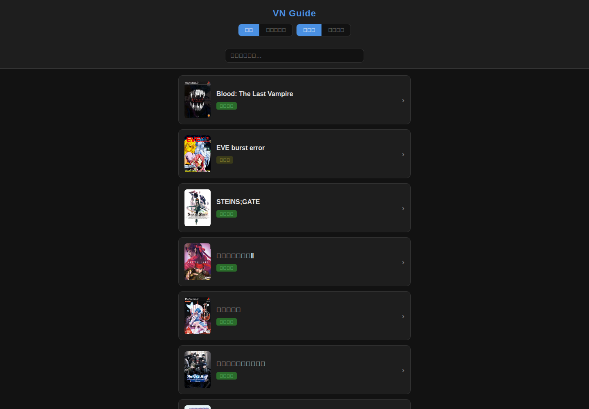

# VN Guide

VN Guide turns Japanese visual-novel and explicitly opted-in linear-game walkthroughs into mobile-friendly, route-by-route guides with local progress tracking.

**Live site:** [kanjieater.github.io/VN-Guide](https://kanjieater.github.io/VN-Guide/)



## Agent workflow

Agents work directly against the repository and pull requests. There is no local autonomous model runner.

Start with [AGENTS.md](AGENTS.md), then follow the canonical material in [agents/](agents/):

- [Guide standards](agents/guide-standards.md)
- [Guide author](agents/guide-author.md)
- [Structural reviewer](agents/guide-reviewer-structural.md)
- [Accuracy reviewer](agents/guide-reviewer-accuracy.md)
- [Review workflow](agents/guide-review.md)

Author, structural-review, and accuracy-review work stay in independent contexts. A guide is complete only when both review gates are clean for the current content and every route is marked `reviewed: true`.

## Deterministic generation

Only mechanical repository output is generated by code:

```bash
bun run generate
```

This synchronizes the landing page and per-game bootstrap/manifest files from the legacy `games.json`, per-game `catalog.json` metadata, and [templates/](templates/). The index-sync workflow commits **only root `index.html`** after merges to `main`, while the existing branch-based GitHub Pages publication stays in place. **Guide PRs must not edit shared `index.html` or `games.json` for new titles.** Per-game bootstrap HTML and manifests remain owned by the game's directory; exceptionally, shared template changes still require updating the affected game-directory bootstrap files.

To register a new title, create `<slug>/catalog.json` with `vndb_id`, `title`, `alttitle`, `cover_url`, `added_at`, and `guide_target` (the latter three as applicable), alongside `guide.json`, `research.json`, and routes. The directory name is the slug. `has_guide` is derived from all routes having `reviewed: true`; do not set it manually. Existing `games.json` entries remain supported and can be migrated one title at a time.

To ensure the bot's index commit triggers the existing branch-based GitHub Pages build, configure the repository Actions secret `INDEX_SYNC_TOKEN` with a fine-grained token permitted to write repository contents. The default `GITHUB_TOKEN` does not trigger a Pages build on its own commit. No Pages publishing-source change is needed.

Research, guide authoring, corrections, and reviews are agent work, not generator-script work.

## Tests and coverage

The repository uses Bun for dependency installation, test execution, and coverage:

```bash
bun install
bun test
bun run test:coverage
```

Tests are use-case driven. Bun's native `--parallel` mode gives every test file a fresh global while scheduling files across CPU cores; independent tests within a file may additionally run concurrently with a maximum concurrency of 20. They exercise reader resume/navigation, route transitions, spoiler behavior, bad-end/load handling, flowchart preview/commit and zoom interactions, detailed sidecar topology, landing-page progress filtering, and deterministic generation.

CI reports whole-code coverage and enforces **100% changed-line coverage** for production application/generator modules. The gate discovers production `.js`/`.mjs` files dynamically; only explicit CI/test entrypoints are excluded, so a newly added runtime module cannot silently bypass coverage.
